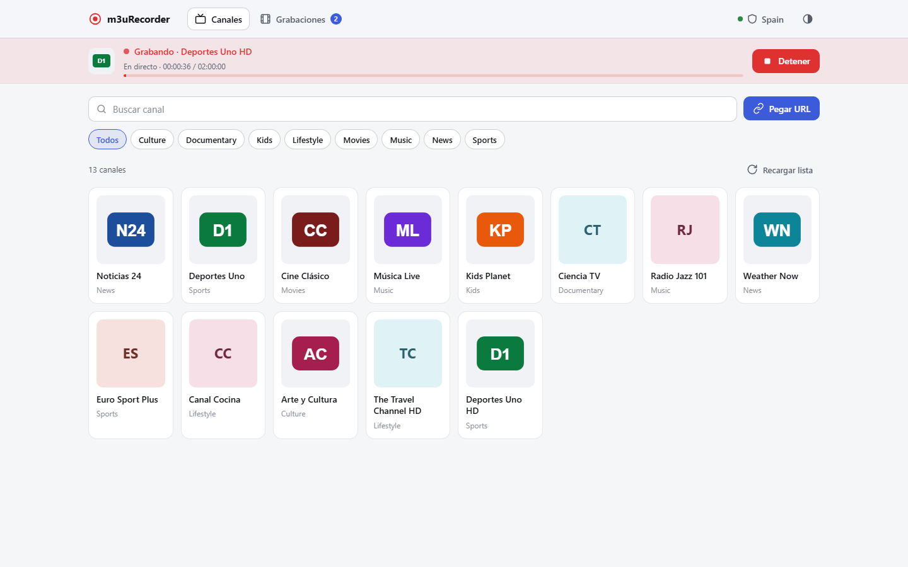
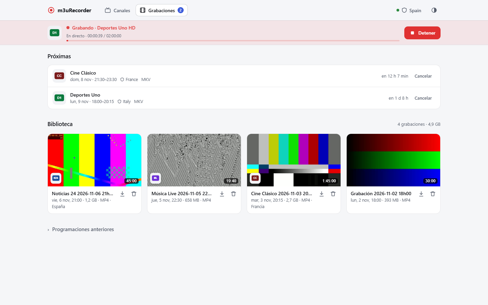
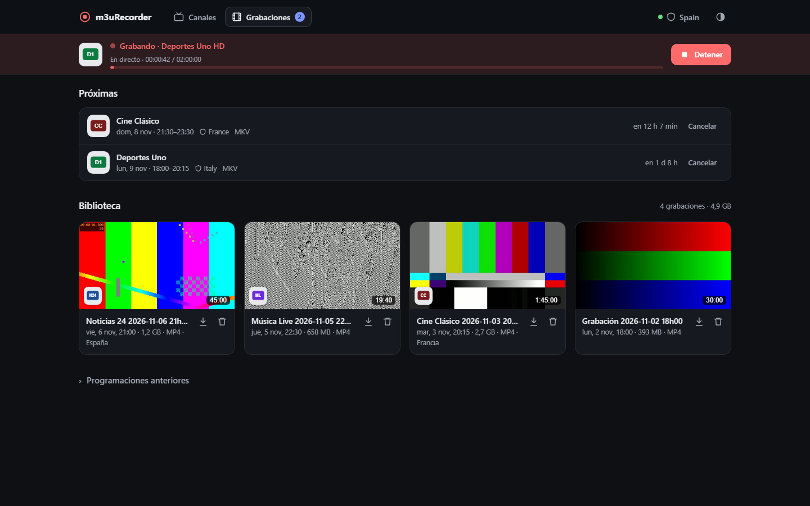
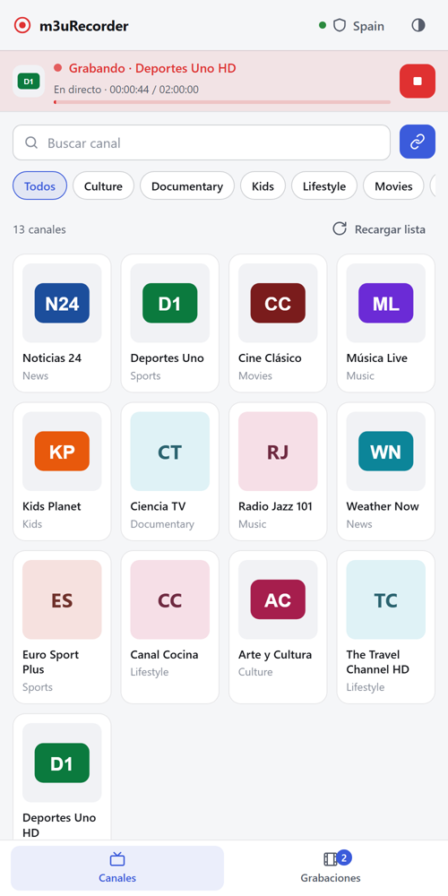
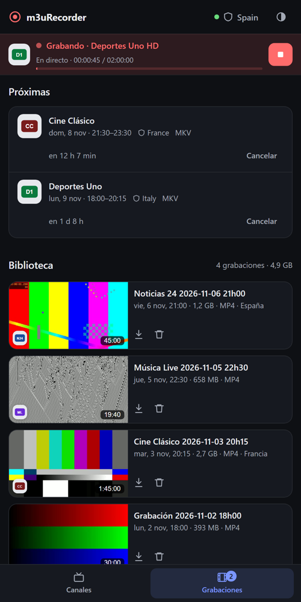
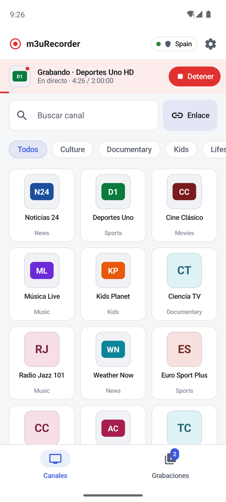
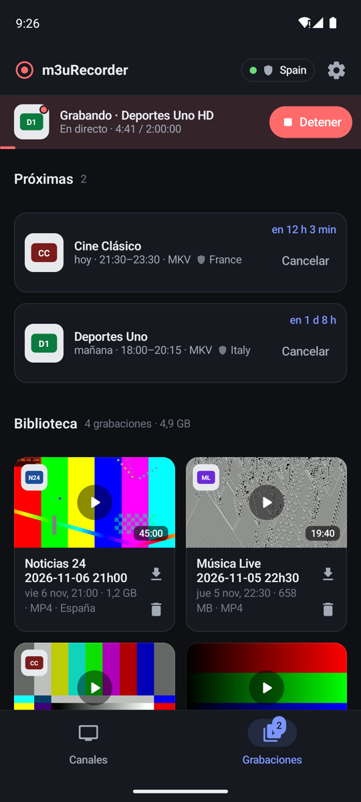
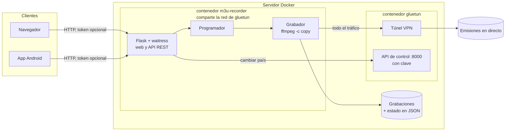

<p align="center">
  
</p>

<h1 align="center">m3uRecorder</h1>

<p align="center">
  Un grabador (DVR) autoalojado para emisiones en directo: elige un canal de una lista M3U, grábalo ya<br>
  o prográmalo, y míralo después — si quieres, a través de una VPN y con un país distinto para cada grabación.
</p>

<p align="center">
  <a href="https://github.com/allopism/m3uRecorder/actions/workflows/ci.yml"></a>
  <a href="LICENSE"></a>
  
  
</p>

<p align="center">
  <a href="README.md">English</a> · <b>Español</b>
</p>

---

## Funciones

- **Graba ahora o programa.** Un solo panel para las dos cosas: duraciones rápidas (15 min … 3 h) o
  una hora de inicio y fin, con cuenta atrás para las próximas grabaciones.
- **Sin pérdida de calidad.** Las emisiones se copian con `ffmpeg -c copy` (sin recodificar) y se
  guardan en MP4, MKV (conserva todas las pistas de audio y los subtítulos), TS o AVI.
- **Resistente a cortes.** Si la emisión se cae, se reconecta y une los trozos; el `.ts` intermedio
  no se borra nunca hasta que el archivo final está guardado.
- **País de la VPN por grabación** con [Gluetun](https://github.com/qdm12/gluetun): cambia de país
  justo antes de empezar y vuelve al anterior al terminar — útil para canales en abierto con
  restricción geográfica.
- **Programaciones seguidas.** Las programadas graban un margen extra al final y la siguiente toma el
  relevo en cuanto le toca.
- **Una biblioteca de verdad.** Miniaturas, logo del canal, duración y tamaño; reproduce en el
  navegador (con cualquier pista de audio) o descarga.
- **Tema claro y oscuro**, adaptable desde el móvil hasta el escritorio.
- **App Android complementaria** con notificación de grabación (cuenta atrás y botón Detener) —
  ver [m3uRecorder-android](https://github.com/allopism/m3uRecorder-android).
- **Avisos por Telegram** (opcional) al empezar, terminar o fallar una grabación.

<table>
  <tr>
    <td width="50%"></td>
    <td width="50%"></td>
  </tr>
  <tr>
    <td align="center">Próximas grabaciones y biblioteca</td>
    <td align="center">Tema oscuro</td>
  </tr>
</table>

<p align="center">
  
  
  
  
</p>
<p align="center"><sub>Web en el móvil (izquierda) y la app Android (derecha)</sub></p>

## Cómo funciona



- El contenedor del grabador usa `network_mode: service:gluetun`, así que **todo su tráfico sale
  por la VPN**. El puerto web lo publica el contenedor de Gluetun; la API de control de Gluetun no
  se publica nunca y exige una clave.
- Proceso de grabación: `ffmpeg` escribe fragmentos MPEG-TS → si hay un corte, reintenta hasta
  completar el tiempo pedido → los fragmentos se unen y se convierten (sin recodificar) al formato
  elegido → se comprueba la duración con `ffprobe` → miniatura → entrada en el historial.
- El estado (historial, programaciones, avisos) se guarda en pequeños JSON junto a las grabaciones,
  con escritura atómica. Miniaturas y logos se guardan en una carpeta oculta `.cache`.

## Puesta en marcha

Requisitos: Docker con Compose y una cuenta de VPN compatible con Gluetun
([proveedores](https://github.com/qdm12/gluetun-wiki)) — o sin VPN (ver más abajo).

```bash
git clone https://github.com/allopism/m3uRecorder.git
cd m3uRecorder
cp .env.example .env        # y edítalo
docker compose up -d
```

Abre `http://<tu-servidor>:9984`.

Lo mínimo que hay que poner en `.env`:

| Variable | Qué es |
|---|---|
| `M3U_LIST_PATH` | Tu lista de canales (`.m3u` / `.m3u8`) |
| `RECORDINGS_DIR` | Dónde se guardan las grabaciones en el servidor |
| `PUID` / `PGID` | Dueño de esa carpeta (`id -u` / `id -g`); la app no se ejecuta como root |
| `VPN_SERVICE_PROVIDER`, `OPENVPN_USER`, `OPENVPN_PASSWORD`, `SERVER_COUNTRIES` | Ajustes de Gluetun |
| `GLUETUN_API_KEY` | **Obligatoria.** Clave de la API de control de Gluetun (`openssl rand -hex 24`) |
| `APP_TOKEN` | Opcional. Activa el inicio de sesión en la web y en la API (`openssl rand -hex 24`) |
| `TELEGRAM_BOT_TOKEN`, `TELEGRAM_CHAT_ID` | Opcional. Avisos por Telegram |

El `docker-compose.yml` descarga una imagen ya construida de GHCR (`linux/amd64` y `linux/arm64`).
Para construirla tú, cambia la línea `image:` por `build: .`.

### Sin VPN

Pon `VPN_ENABLED=false`, quita el servicio `gluetun` y la línea `network_mode`, y publica el puerto
en el propio grabador (`ports: ["9984:5000"]`). Los controles de la VPN desaparecen de la interfaz.

## Seguridad

- **Úsalo en tu red local** (o detrás de tu propia VPN, como WireGuard). No está pensado para
  exponerlo a internet.
- Con `APP_TOKEN`, la web pide iniciar sesión (cookie HttpOnly y SameSite) y la API acepta
  `Authorization: Bearer <token>`. Los enlaces de descarga y reproducción pueden llevar una firma
  HMAC por archivo, para que reproductores externos (VLC…) abran una grabación sin conocer el token.
- Las URL de emisión se limitan a protocolos de red (`http`, `https`, `rtmp`, `rtsp`, `udp`, `srt`…):
  se rechazan trucos como `file:` o `concat:`. Solo se pueden borrar archivos de vídeo.
- El proxy de logos solo descarga URL que aparecen en la lista cargada, solo de direcciones IP
  públicas (también tras redirecciones), solo imágenes y con un tamaño máximo.
- La API de control de Gluetun está protegida con `GLUETUN_API_KEY`. Comprueba que no quede un
  `vpn/auth/config.toml` antiguo: tendría prioridad sobre esa clave.

## Desarrollo

```bash
python -m venv .venv
source .venv/bin/activate          # Windows: .venv\Scripts\activate
pip install -r requirements.txt -r requirements-dev.txt
ruff check .
pytest                             # los tests de grabación necesitan ffmpeg en el PATH
VPN_ENABLED=false python app.py    # http://localhost:5000
```

La CI (GitHub Actions) ejecuta `ruff` y `pytest`, construye la imagen Docker y comprueba `/healthz`.
Al etiquetar una versión (`v*`) se publica la imagen en GHCR.

<details>
<summary>Estructura del proyecto</summary>

```
m3urecorder/
├── __init__.py      app, servicios, servidor waitress y señales de apagado
├── settings.py      configuración desde variables de entorno
├── routes.py        web y API REST
├── auth.py          inicio de sesión con token, cabecera Bearer, enlaces firmados
├── recorder.py      ciclo de una grabación: reintentos, relevo, VPN por grabación
├── scheduler.py     arranca las programadas a su hora
├── media.py         ffmpeg/ffprobe: captura, conversión, miniaturas, información
├── vpn.py           cliente de la API de control de Gluetun
├── channels.py      lectura y búsqueda de la lista M3U
├── logos.py         proxy seguro de logos con caché
├── storage.py       almacenes JSON atómicos (historial, programadas, avisos)
├── timeutils.py     zonas horarias y cambios de hora
├── templates/       plantillas Jinja
└── static/          CSS y JavaScript (sin compilación)
tests/               tests con pytest (API, auth, programador, grabaciones reales con ffmpeg…)
```

</details>

<details>
<summary>API REST (la usa la app Android)</summary>

| Método | Ruta | Descripción |
|---|---|---|
| GET | `/status` | Grabación en curso, VPN, contadores |
| GET | `/api/channels?q=&group=` · `/api/channels/groups` | Búsqueda de canales y categorías |
| POST | `/record` | Empezar a grabar (`url`, `duration`, `filename`, `format`, `vpn_country`) |
| POST | `/stop` | Detener la grabación de forma segura |
| POST | `/schedule` · GET `/schedules` | Crear / listar programadas |
| POST | `/schedules/cancel/<id>` · `/schedules/delete/<id>` | Cancelar / quitar |
| GET | `/history` · POST `/history/delete/<archivo>` | Biblioteca |
| GET | `/stream/<archivo>` · `/download/<archivo>` · `/thumb/<archivo>` | Vídeo, descarga y miniatura |
| GET | `/api/media-info/<archivo>` | Duración, códecs, pistas de audio y firma `sig` |
| GET / POST | `/api/vpn/countries` · `/api/vpn/country` | Países de la VPN / cambiar |
| GET | `/healthz` | Comprobación de salud (sin auth) |

</details>

## Uso responsable

m3uRecorder es una herramienta para grabar emisiones a las que **tienes derecho a acceder**, como
canales en abierto que las propias cadenas publican libremente. No incluye, busca ni proporciona
ningún contenido ni lista de canales. Eres responsable de las listas que cargues y de cumplir la ley
de tu país y las condiciones de cada cadena y de tu proveedor de VPN. Las grabaciones son para uso
personal.

## Licencia

[MIT](LICENSE) © 2026 Andrés Llopis
