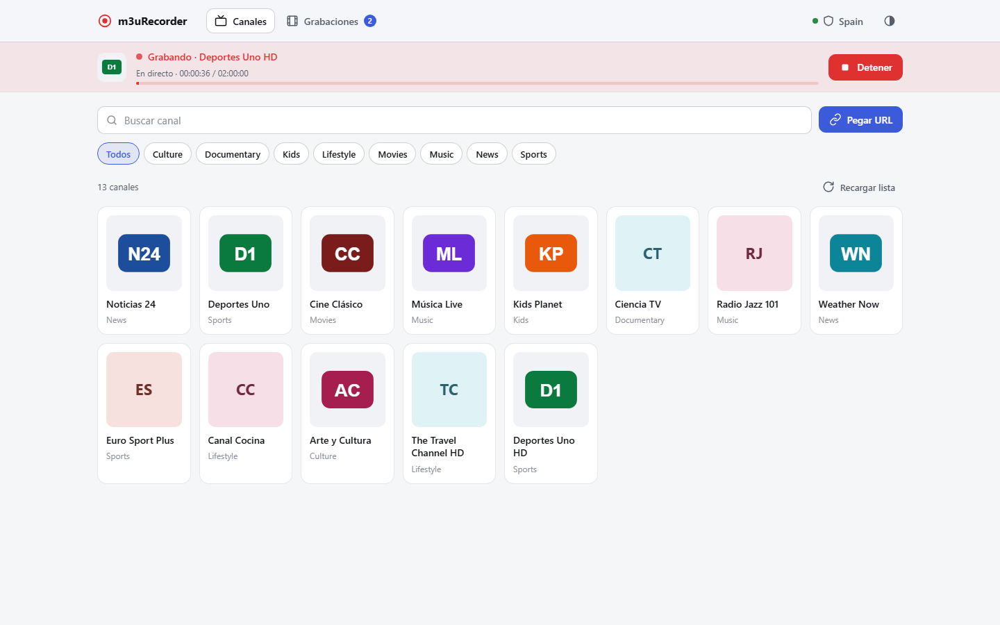
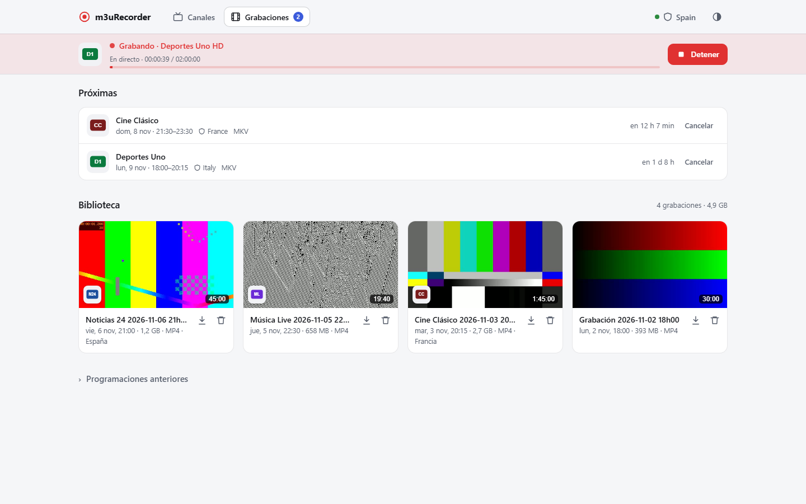
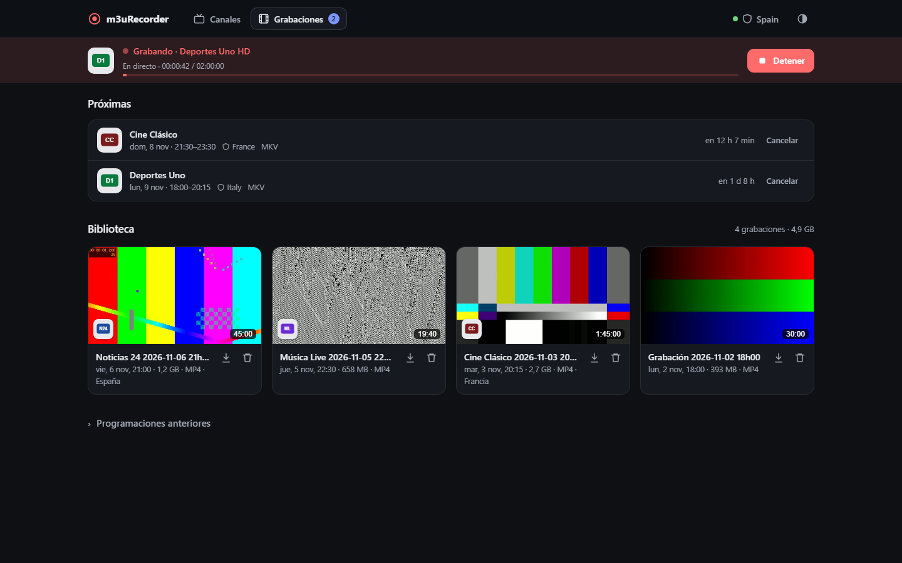
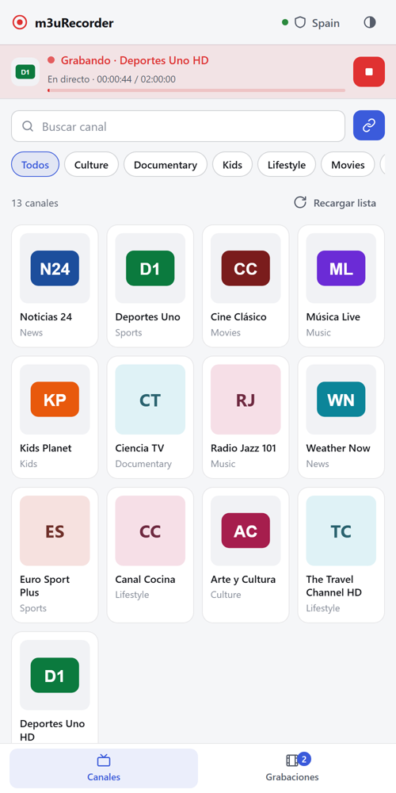
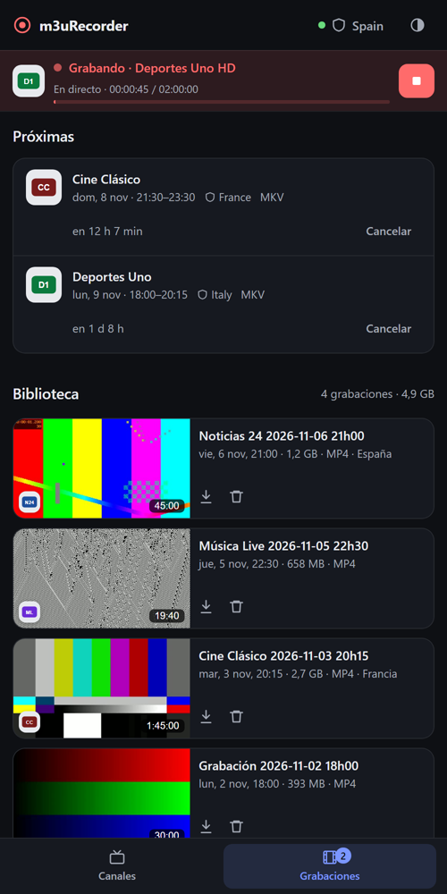
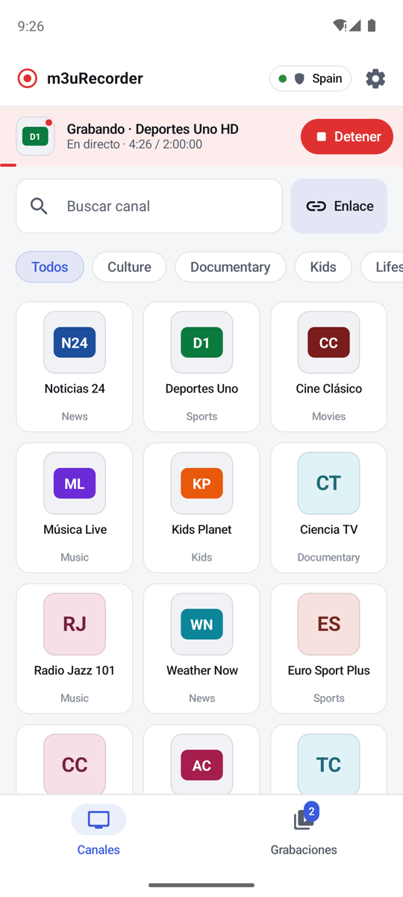
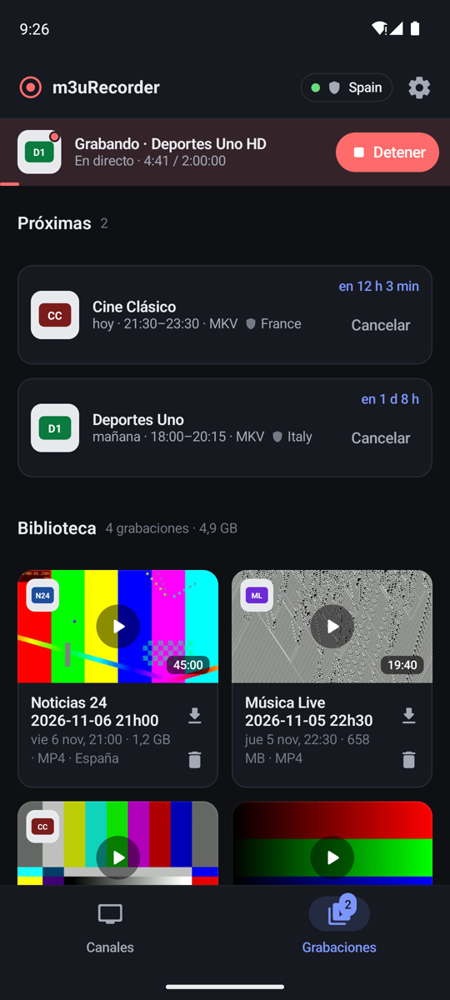
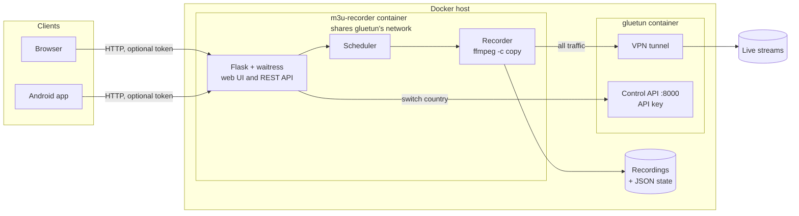

<p align="center">
  
</p>

<h1 align="center">m3uRecorder</h1>

<p align="center">
  A self-hosted DVR for live streams: pick a channel from an M3U list, record it now or schedule it,<br>
  and watch it later — optionally through a VPN, with a different country for each recording.
</p>

<p align="center">
  <a href="https://github.com/allopism/m3uRecorder/actions/workflows/ci.yml"></a>
  <a href="LICENSE"></a>
  
  
</p>

<p align="center">
  <b>English</b> · <a href="README.es.md">Español</a>
</p>

---

## Features

- **Record now or schedule.** One panel for both: quick durations (15 min … 3 h) or a start/end time,
  with a live countdown for upcoming recordings.
- **Lossless.** Streams are copied with `ffmpeg -c copy` (no re-encoding) and saved as MP4, MKV
  (keeps every audio track and subtitles), TS or AVI.
- **Resilient.** If the stream drops, the recorder reconnects and stitches the pieces together; an
  intermediate `.ts` file is never deleted until the final file is safely written.
- **Per-recording VPN country** through [Gluetun](https://github.com/qdm12/gluetun): switch country
  just before a recording starts and switch back when it ends — useful for region-restricted
  free-to-air channels.
- **Back-to-back schedules.** Scheduled recordings keep a safety margin at the end, and the next one
  takes over the capture slot the moment it is due.
- **A library that looks like one.** Thumbnails, channel logos, duration and size; play recordings in
  the browser (any audio track) or download them.
- **Light and dark themes**, responsive from phones to desktops.
- **Android companion app** with a recording notification (countdown + Stop button) —
  see [m3uRecorder-android](https://github.com/allopism/m3uRecorder-android).
- **Telegram notifications** (optional) when a recording starts, finishes or fails.

<table>
  <tr>
    <td width="50%"></td>
    <td width="50%"></td>
  </tr>
  <tr>
    <td align="center">Upcoming recordings and library</td>
    <td align="center">Dark theme</td>
  </tr>
</table>

<p align="center">
  
  
  
  
</p>
<p align="center"><sub>Mobile web (left) and the Android companion app (right)</sub></p>

## How it works



- The recorder container uses `network_mode: service:gluetun`, so **all of its traffic leaves
  through the VPN**. The web port is published by the Gluetun container; Gluetun's control API is
  never published and requires an API key.
- Recording pipeline: `ffmpeg` writes MPEG-TS segments → on a drop, it retries until the requested
  time is reached → the segments are concatenated and remuxed (still without re-encoding) to the
  chosen container → duration check with `ffprobe` → thumbnail → history entry.
- State (history, schedules, notifications) lives in small JSON files next to the recordings,
  written atomically. Thumbnails and logos are cached in a hidden `.cache` folder.

## Quick start

Requirements: Docker with Compose, and a VPN account supported by Gluetun
([list of providers](https://github.com/qdm12/gluetun-wiki)) — or skip the VPN (see below).

```bash
git clone https://github.com/allopism/m3uRecorder.git
cd m3uRecorder
cp .env.example .env        # then edit it
docker compose up -d
```

Open `http://<your-server>:9984`.

What to put in `.env` at minimum:

| Variable | What it is |
|---|---|
| `M3U_LIST_PATH` | Your channel list (`.m3u` / `.m3u8`) |
| `RECORDINGS_DIR` | Where recordings are saved on the host |
| `PUID` / `PGID` | Owner of that folder (`id -u` / `id -g`); the app does not run as root |
| `VPN_SERVICE_PROVIDER`, `OPENVPN_USER`, `OPENVPN_PASSWORD`, `SERVER_COUNTRIES` | Gluetun settings |
| `GLUETUN_API_KEY` | **Required.** Key for Gluetun's control API (`openssl rand -hex 24`) |
| `APP_TOKEN` | Optional. Enables a login for the web UI and the API (`openssl rand -hex 24`) |
| `TELEGRAM_BOT_TOKEN`, `TELEGRAM_CHAT_ID` | Optional. Telegram notifications |

The `docker-compose.yml` pulls a prebuilt image from GHCR (`linux/amd64` and `linux/arm64`).
To build it yourself instead, replace the `image:` line with `build: .`.

### Without a VPN

Set `VPN_ENABLED=false`, remove the `gluetun` service and the `network_mode` line, and publish the
port on the recorder itself (`ports: ["9984:5000"]`). The VPN controls disappear from the UI.

## Security notes

- **Keep it on your LAN** (or behind your own VPN such as WireGuard). It is not designed to be
  exposed to the internet.
- With `APP_TOKEN` set, the web UI requires a login (HttpOnly, SameSite cookie) and the API accepts
  `Authorization: Bearer <token>`. Download and playback links can carry a per-file HMAC signature,
  so external players (VLC…) can open a recording without knowing the token.
- Stream URLs are restricted to network protocols (`http`, `https`, `rtmp`, `rtsp`, `udp`, `srt`…),
  so `file:` or `concat:` tricks are rejected. Only media files can be deleted.
- The channel-logo proxy only fetches URLs that appear in the loaded list, only from public IP
  addresses (also after redirects), only images, and with a size limit.
- Gluetun's control API is protected by `GLUETUN_API_KEY`. Make sure there is no
  `vpn/auth/config.toml` left over: it would take precedence over that key.

## Development

```bash
python -m venv .venv
source .venv/bin/activate          # Windows: .venv\Scripts\activate
pip install -r requirements.txt -r requirements-dev.txt
ruff check .
pytest                             # needs ffmpeg in PATH for the recording tests
VPN_ENABLED=false python app.py    # http://localhost:5000
```

CI (GitHub Actions) runs `ruff` and `pytest`, builds the Docker image and checks `/healthz`.
Tagging a release (`v*`) publishes the image to GHCR.

<details>
<summary>Project structure</summary>

```
m3urecorder/
├── __init__.py      app factory, services, waitress server and signal handling
├── settings.py      configuration from environment variables
├── routes.py        web UI and REST API
├── auth.py          token login, Bearer header, signed file links
├── recorder.py      recording lifecycle: retries, handover, VPN per recording
├── scheduler.py     starts scheduled recordings on time
├── media.py         ffmpeg/ffprobe: capture, remux, thumbnails, media info
├── vpn.py           Gluetun control API client
├── channels.py      M3U parsing and search
├── logos.py         safe logo proxy with cache
├── storage.py       atomic JSON stores (history, schedules, notifications)
├── timeutils.py     time zones and daylight-saving transitions
├── templates/       Jinja templates
└── static/          CSS and JavaScript (no build step)
tests/               pytest suite (API, auth, scheduler, real ffmpeg recordings…)
```

</details>

<details>
<summary>REST API (used by the Android app)</summary>

| Method | Path | Description |
|---|---|---|
| GET | `/status` | Current recording, VPN, counters |
| GET | `/api/channels?q=&group=` · `/api/channels/groups` | Channel search and groups |
| POST | `/record` | Start a recording (`url`, `duration`, `filename`, `format`, `vpn_country`) |
| POST | `/stop` | Stop the current recording safely |
| POST | `/schedule` · GET `/schedules` | Create / list scheduled recordings |
| POST | `/schedules/cancel/<id>` · `/schedules/delete/<id>` | Cancel / remove |
| GET | `/history` · POST `/history/delete/<file>` | Library |
| GET | `/stream/<file>` · `/download/<file>` · `/thumb/<file>` | Media |
| GET | `/api/media-info/<file>` | Duration, codecs, audio tracks and signed-link `sig` |
| GET / POST | `/api/vpn/countries` · `/api/vpn/country` | VPN countries / switch |
| GET | `/healthz` | Health check (no auth) |

</details>

## Responsible use

m3uRecorder is a tool for recording streams that **you are allowed to access**, such as free-to-air
channels that broadcasters publish openly. It does not include, find or provide any content or
channel list. You are responsible for the lists you load and for complying with the law of your
country and with the terms of each broadcaster and VPN provider. Recordings are for personal use.

## License

[MIT](LICENSE) © 2026 Andrés Llopis
